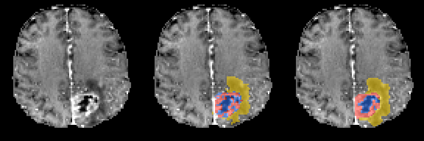
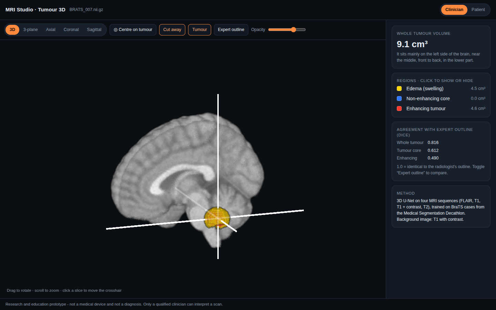
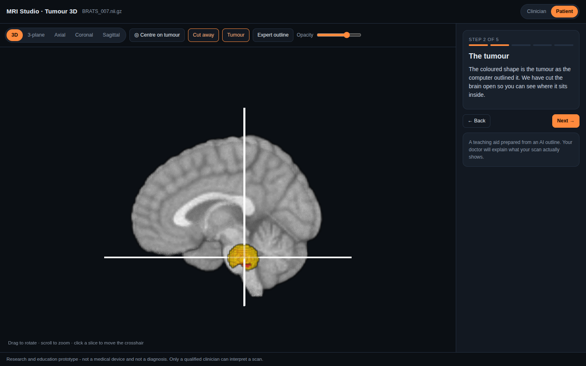

# MRI Studio: explainable brain-tumour analysis in 3D

MRI Studio takes a brain MRI, outlines the tumour in 3D and shows the result in an interactive viewer. The viewer has two modes: a clinician view with measurements, and a patient view that walks through the scan step by step in plain language.

> Research and education project. It is not a medical device, and its output is not a diagnosis.



*Left to right: the scan, the radiologist's outline, and this model's outline, on a case the model never trained on. Yellow is edema, red is the non-enhancing core, blue is enhancing tumour.*

## Results

**3D tumour segmentation**, on 48 held-out BraTS cases the model never saw. Dice measures overlap with the radiologist's outline, where 1.0 is perfect.

| Region | Mean Dice | Median Dice |
|---|---|---|
| Whole tumour | 0.857 | 0.890 |
| Tumour core | 0.754 | 0.820 |
| Enhancing tumour | 0.656 | 0.743 |

Published BraTS methods reach roughly 0.9 Dice on whole tumour, using much larger models, full resolution and days of GPU training. This model trades some accuracy for training on a laptop.

**2D tumour classifier** (glioma, meningioma, pituitary tumour or no tumour), on a held-out test split:

| Accuracy | Balanced accuracy | Sensitivity | Specificity | AUC |
|---|---|---|---|---|
| 97.4% | 98.3% | 97.4% | 99.1% | 0.999 |

Raw numbers: [`results/`](results/).

## What it does

| Part | What it does | Code |
|---|---|---|
| 3D tumour segmentation | A 3D U-Net reads four MRI sequences and labels every voxel as edema, non-enhancing core or enhancing tumour | `brain_tumour_seg.py` |
| 2D tumour classifier | A fine-tuned ResNet50 classifies a slice into one of four classes | `brain_mri_classifier.py` |
| Explainability | Grad-CAM heatmaps show which part of the image drove the classifier's decision | `mri_studio.py` |
| Interactive 3D viewer | A WebGL viewer (NiiVue): rotate, cut away, 3-plane slices, show or hide each region, compare with the expert outline | `static/` |
| Patient walkthrough | A 5-step guided explanation of the scan in plain language | `static/seg_viewer_template.html` |
| Shareable output | Each result exports as one self-contained HTML file | `mri_studio.py` |

| Clinician view | Patient walkthrough |
|---|---|
|  |  |

*The interactive viewer, shown on the synthetic demo lesion in `samples/` (not patient data). Left: the clinician view with a 3D cut-away, volume of each region and agreement with the expert outline. Right: step 2 of the 5-step patient walkthrough.*

**See the viewer without installing anything:** download [`samples/example_tumour3d_viewer_SYNTHETIC.html`](samples/example_tumour3d_viewer_SYNTHETIC.html) and open it in a browser. It uses a synthetic lesion, not patient data.

## Run it

```bash
python3 -m venv .venv
source .venv/bin/activate
pip install -r requirements.txt

# 1. check the 3D model runs on this machine (prints a speed estimate)
python brain_tumour_seg.py selftest

# 2. data: Medical Segmentation Decathlon Task01 (484 BraTS cases, ~7 GB, no registration)
python brain_tumour_seg.py download --out data

# 3. preprocess once (crop, normalise, resample)
python brain_tumour_seg.py prepare --data data/Task01_BrainTumour --out data/prep --size 128 128 96

# 4. train, then score the held-out test cases
python brain_tumour_seg.py train --prep data/prep --out runs/seg --epochs 60
python brain_tumour_seg.py evaluate --prep data/prep --ckpt runs/seg/best_seg.pt

# 5. launch the app
python mri_studio.py --seg-checkpoint runs/seg/best_seg.pt --checkpoint runs/kaggle/best_model.pt
```

**Faster option:** use `--size 96 96 64 --out data/prep96` in step 3, then `--prep data/prep96 --epochs 40` in step 4. It trains about 2.5× faster with slightly coarser outlines.

**Fair demo:** pick a case listed under `"test"` in `runs/seg/split.json` and add its matching file from `labelsTr/` as the expert label. The model never trained on these cases, so the Dice score shown is a fair measure.

Datasets and trained weights are not included in this repository; the steps above download and train them.

**Tests** (CPU only, no data or weights needed, about 20 s):

```bash
pip install -r requirements-dev.txt
pytest -q tests
```

They check the 3D U-Net's output shape and size, that the loss falls when it overfits one case, the Dice metric, cropping and normalisation, that no case or patient appears in more than one split, left/right tumour labelling, and the growth rule (a change counts as growth only above both 20% and the measurement-noise limit). GitHub Actions runs them on every push.

## How it works

1. **Preprocessing:** each of the four sequences (FLAIR, T1, T1 with contrast, T2) is reoriented to a standard orientation, cropped to the brain, z-score normalised over brain voxels and resampled to a fixed grid.
2. **Model:** a 3D U-Net with 5 levels (16 to 256 channels), instance normalisation and skip connections, about 5.6M parameters.
3. **Training:** cross-entropy plus soft Dice loss, AdamW with a one-cycle learning-rate schedule, random flips and intensity jitter, and a case-level 80/10/10 split.
4. **Inference:** predictions are averaged with a left-right flipped copy, resampled back to the original scan grid and saved as NIfTI. Volumes are reported in cm³.
5. **Viewer:** the MRI and label volumes are embedded in one HTML page and rendered with NiiVue (WebGL2).

## Limitations

- **Coarse grid:** trained at 128×128×96, not the full 240×240×155 resolution, so small enhancing regions are the hardest to get right (the lowest Dice above).
- **Data:** BraTS contains gliomas only, from pre-operative scans with four sequences, so other tumour types or missing sequences are out of scope.
- **Location text:** the description is relative to the brain's centre, not anatomical lobes.
- **Validation:** no clinical validation has been done, so this is not for patient care.

## Data and credits

- **Segmentation data:** Medical Segmentation Decathlon, Task01_BrainTumour (CC-BY-SA 4.0): Simpson et al., *A large annotated medical image dataset for the development and evaluation of segmentation algorithms*, arXiv:1902.09063. The underlying BraTS data is from Menze et al., IEEE TMI 2015 and Bakas et al., Scientific Data 2017. The example images in `docs/` are derived from this dataset under the same licence.
- **Classifier data:** the Kaggle "Brain Tumor MRI Dataset" (Masoud Nickparvar).
- **Viewer:** NiiVue (BSD-2-Clause), Copyright (c) NiiVue contributors.
- **Demo volume:** based on the MNI ICBM152 2009 template, Copyright (C) 1993–2009 Louis Collins, McConnell Brain Imaging Centre, Montreal Neurological Institute, McGill University. Used under its permission notice, which requires this copyright notice in all copies.

---

# Part 2 · Tumour growth tracker (NF2-related schwannomatosis)

**Research question:** how large must a change in tumour volume be before an automated
measurement can call it real growth, and how does that depend on tumour size?

The standard rule defines vestibular schwannoma (VS) growth as a 20% volume increase. The dataset
authors note that "for very small tumours, higher limits should be employed ... as inter-observer
variability can exceed the standard criteria." This tracker measures that limit for its own model.

| Part | What it does |
|---|---|
| Segmentation | A patch-based 3D U-Net on contrast T1 MRI, with sliding-window inference and flip averaging |
| Bilateral handling | Keeps up to two tumours and labels them left or right (bilateral VS is the hallmark of NF2-related schwannomatosis) |
| Reliability | On held-out patients: Dice, volume agreement (Bland-Altman) and **minimum detectable change (MDC95) by tumour size** |
| Growth flags | A change counts as growth only if it exceeds both 20% and the MDC95 for that tumour size; changes in between are marked "possible growth (within measurement noise)" |
| Viewer | Volume-over-time chart, click any date to see that scan in 3D, and a 5-step patient walkthrough |

## Status

The tracker code, evaluation and viewer are built. The model has not been trained yet, so there are no results to report; the tracker tab already works on the dataset's expert outlines.

## Run it

1. **Download the data:** Vestibular-Schwannoma-MC-RC2 from TCIA (about 6 GB of NIfTI, CC BY 4.0,
   DOI 10.7937/BQ0Z-XA62). It downloads through the IBM Aspera Connect browser plugin. Unzip it anywhere, for example `~/vs_data`.
2. **Train and evaluate:**

```bash
python vs_tracker.py index    --data ~/vs_data --out data/vs_index.csv
python vs_tracker.py prepare  --index data/vs_index.csv --out data/vs_prep
caffeinate -i python vs_tracker.py train --prep data/vs_prep --out runs/vs --epochs 50
python vs_tracker.py evaluate --prep data/vs_prep --ckpt runs/vs/best_vs.pt
python vs_tracker.py track --patient VS_MC_RC2_001 --out tracker_001.html     # one patient's timeline
python mri_studio.py            # finds runs/vs/best_vs.pt automatically -> "Tumour growth tracker" tab
```

Splits are by **patient**, so every scan of a test patient stays unseen during training. The tracker tab
also works with no model at all: tick "Use expert outlines" to explore the expert measurements.

**Data credit:** Vestibular-Schwannoma-MC-RC2, The Cancer Imaging Archive, CC BY 4.0, DOI 10.7937/BQ0Z-XA62.
**Limitations:** vestibular schwannoma only, on contrast T1. It has not been validated on NF1 plexiform neurofibromas; that is the next step, working with clinical collaborators.

## License

The code is MIT-licensed; see [LICENSE](LICENSE). The bundled viewer library, demo volume and example images keep their own licenses, listed in [LICENSE](LICENSE) and under *Data and credits* above.
